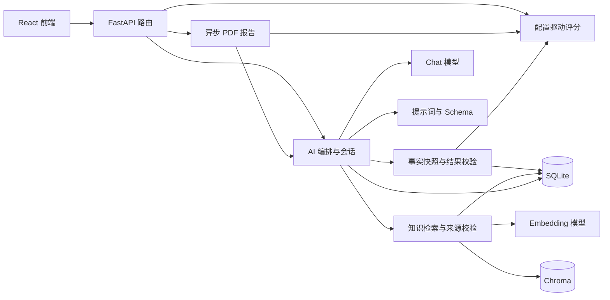

# 客情评估智能体

基于客情因子自动评分，融合 RAG 知识库与 AI 策略建议，输出可溯源的分析报告。

[](backend/requirements.txt)
[](#快速开始)
[](backend/requirements.txt)
[](frontend/package.json)
[](frontend/package.json)
[](frontend/package.json)
[](frontend/package.json)
[](#许可证)

## 功能

- **客户库**：资料编辑、Excel 导入、客情评分与历史趋势。
- **AI 对话**：综合评估与自由问答，提供总体评估、风险、优势和下一步计划，支持引用溯源、重新生成及完整结果复制。
- **知识库**：文档上传、审核、检索、编辑、删除与重索引。
- **PDF 报告**：异步生成评分明细、趋势、分析和行动建议。

## 架构



## AI 与事实边界

**事实严格，判断开放。** 客户原值、评分与历史事实由数据库和评分引擎提供；AI 负责业务判断与行动建议。结果通过结构及来源校验后展示，模型不可用时使用规则兜底。知识来源会标注哪些资料被回答引用，哪些只是检索结果。

## 快速开始

环境：Python 3.11+，Node.js 22.13+ 的 22.x 或 24+。

### 本地开发

在项目根目录执行：

```powershell
python -m venv backend/.venv
./backend/.venv/Scripts/python.exe -m pip install -r backend/requirements.txt
./backend/.venv/Scripts/python.exe -m pip install -r backend/requirements-prod.txt
if (!(Test-Path backend/.env)) { Copy-Item .env.example backend/.env }
Set-Location frontend
npm ci
Set-Location ..
```

在 `backend/.env` 配置 Chat、Embedding 的地址、模型、密钥和 `EMBEDDING_DIM`。未配置 Chat 时使用规则结果；开发测试可设置 `KNOWLEDGE_VECTOR_STORE=memory`。

双击 `start.bat`，或在 Linux / Git Bash 中运行 `bash start.sh`。访问 [前端 :5173](http://localhost:5173) 和 [API 文档 :8000/docs](http://localhost:8000/docs)。

### Docker 部署

准备 `backend/.env` 和密钥文件后执行：

```powershell
python backend/scripts/encrypt_env.py --env backend/.env --key-file ./.ch_secret
docker compose up -d --build
```

访问 [localhost](http://localhost)。数据持久化至 `./data`；已有加密配置须使用配套密钥。远程部署见 [deploy.sh](deploy.sh)。

## 配置与代码

| 文件或目录 | 用途 |
| --- | --- |
| [.env.example](.env.example) → `backend/.env` | 模型连接、生成预算、数据路径与资源限制 |
| [backend/config.py](backend/config.py) | 完整环境变量及默认值 |
| [backend/scoring_config.yaml](backend/scoring_config.yaml) | 评分维度、因子、选项及告警规则；修改后重启后端 |
| [backend/services/ai/](backend/services/ai/) | 会话、模型适配、分析编排与事实校验 |
| [ai/assets/](backend/services/ai/assets/) | 提示词、Schema、版本与 SHA256 清单 |
| [backend/services/rag/](backend/services/rag/) | 知识检索与索引生命周期 |
| [backend/services/report_builder.py](backend/services/report_builder.py) | 报告数据聚合 |
| [frontend/src/pages/](frontend/src/pages/) | 前端页面 |

评分配置修改后重启后端。AI 资产逐请求读取并校验哈希，提示词或 Schema 修改后须更新清单并整套发布。

## 评分模型

7 个维度、28 个因子；因子映射为 0–10 分，维度内取均值：

`总分 = Σ(维度内因子均分 × 维度权重 ÷ 10)`

| 维度 | 权重 | 因子数 |
| --- | --- | --- |
| KCR 关键客户关系 | 30 | 6 |
| ER 普遍客户关系 | 18 | 4 |
| OR 组织客户关系 | 14 | 3 |
| CI 客户洞察与业务理解 | 9 | 3 |
| HIS 历史合作与经营结果 | 12 | 4 |
| RISK 竞争态势与风险信号 | 12 | 5 |
| SVC 服务与支持健康度 | 5 | 3 |

健康 ≥80，亚健康 60–<80，风险 40–<60，高危 <40。资料缺失或选项无效会单独提示，历史趋势按评分配置版本计算。

新增因子：添加客户字段或 `custom_fields` 字段 → 在 YAML 注册评分、选项和告警 → 重启后端。前端通过 `/api/customers/factor-config` 加载表单；Excel 模板从 `/api/customers/import-template` 下载。

## 运行维护

- 备份 SQLite、知识文件和 Chroma 索引，密钥另行保管；已有环境沿用原数据路径。
- Chroma 异常时等待恢复与对账；更换 Embedding 模型或维度后执行重索引。
- `/api/readiness` 检查就绪状态，`/api/chat/status` 查看 AI 配置，`/api/chat/metrics` 查看用量。
- PDF 任务在进程内管理，服务重启后需重新申请导出。
- 系统没有登录与租户隔离，应在受控环境使用。

## 验证

后端在 `backend` 目录运行：

```powershell
./.venv/Scripts/python.exe -m pytest tests/ -q -p no:cacheprovider --basetemp ../.tmp/pytest
```

前端在 `frontend` 目录执行：

```powershell
node node_modules/typescript/bin/tsc -p tsconfig.app.json --noEmit
node node_modules/typescript/bin/tsc -p tsconfig.node.json --noEmit
node node_modules/vite/bin/vite.js build
node node_modules/vitest/vitest.mjs run
```

测试使用隔离数据，功能变更需补浏览器检查。真实模型测试默认跳过，执行前明确样本与累计额度；分析建议的质量由人工验收。

## 许可证

本项目为内部评估工具，保留所有权利，不对外开放授权。
