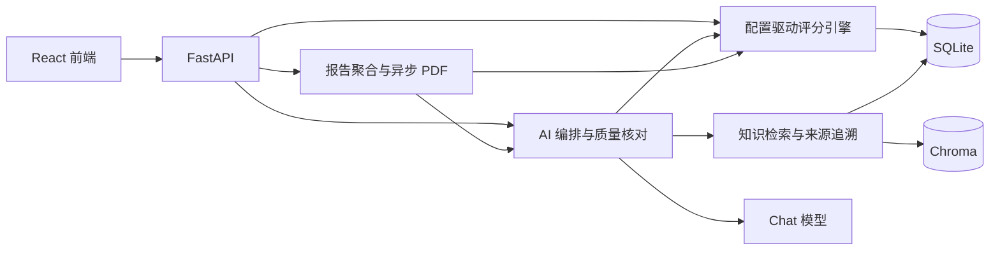

# 客情评估智能体

基于客情因子自动评分，融合 RAG 知识库与 AI 策略建议，输出可溯源的分析报告。

[](backend/requirements.txt)
[](#快速开始)
[](backend/requirements.txt)
[](frontend/package.json)
[](frontend/package.json)
[](frontend/package.json)
[](frontend/package.json)
[](#许可证)

- **客户库 `/customers`**：筛选、新建、Excel 导入、因子编辑（桌面可编辑、移动只读）、评分与历史趋势。
- **AI 对话 `/chat`**：流式综合评估、策略生成、风险排查与自由问答；支持引用溯源、反馈和完整结果复制。策略以总览与分层卡片展示，重新生成成功后替换旧答复；采纳状态仅保存在前端。
- **知识库 `/knowledge`**：文档上传（md/txt/csv/pdf/xlsx/docx）、检索、审核、编辑、删除与重索引。
- **PDF 报告**：评分明细、预警、三层策略建议、知识引用及趋势图。

数据存储使用 SQLAlchemy + SQLite，向量检索使用 Chroma，报告使用 ReportLab + matplotlib；AI 编排与检索管线为项目内实现。

## 架构



## 快速开始

环境：Python 3.10+（建议 3.12）、Node.js 22.13+ 的 22.x 或 24+；前端依赖使用 npm。

### 本地开发

先创建并激活 Python 虚拟环境，再在项目根目录安装依赖：

```bash
pip install -r backend/requirements.txt
pip install -r backend/requirements-prod.txt  # Chroma、PDF/DOCX 文档解析
cd frontend
npm ci
cd ..
```

复制 [.env.example](.env.example) 为 `backend/.env`，填写 Chat 与 Embedding 的 Key、地址、模型及匹配的 `EMBEDDING_DIM`。不配置 Chat 时使用规则引擎；仅开发测试可显式设置 `KNOWLEDGE_VECTOR_STORE=memory`，跳过 Chroma 安装。

```bash
bash start.sh  # Linux / Git Bash；Windows 也可双击 start.bat
```

前端访问 [localhost:5173](http://localhost:5173)，后端为 [localhost:8000](http://localhost:8000)。Shell 启动按 Ctrl+C 停止；Windows 批处理启动需关闭前后端窗口。

启动会创建数据库，但不自动导入客户。需要 13 条演示数据时，在 `backend` 目录执行 `python seed_data.py`，可重复运行。

### Docker 与服务器部署

先准备 `backend/.env`。Compose 还会挂载密钥文件，可在根目录运行以下命令生成密钥并加密配置中的 Key：

```bash
python backend/scripts/encrypt_env.py --env backend/.env --key-file ./.ch_secret
docker compose up -d --build
```

访问 [localhost](http://localhost)。Docker 默认安装生产依赖与中文字体，通过 `./data:/app/data` 持久化数据；已有加密配置须配套原密钥。挂载位置可用 `CH_SECRET_FILE` 覆盖。

远程部署需要本机 Docker、SSH/SCP，以及已安装 Docker、开放 80 端口的服务器。首次同步前准备含有效 Key 的加密配置（Linux / Git Bash，在根目录执行）：

```bash
cp backend/.env .env.prod
python backend/scripts/encrypt_env.py --env .env.prod --key-file ./.ch_secret
DEPLOY_SERVER=root@203.0.113.10 bash deploy.sh  # 替换为实际服务器地址
```

后续默认仅在服务器缺少配置时同步；强制同步用 `SYNC_CONFIG=1`，仅更新镜像用 `SYNC_CONFIG=0`。详见 [deploy.sh](deploy.sh)。

## 配置

| 入口 | 用途 |
| --- | --- |
| [.env.example](.env.example) → `backend/.env` | 模型、向量库、资源限制等运行配置 |
| [config.py](backend/config.py) | 完整环境变量与代码默认值 |
| [scoring_config.yaml](backend/scoring_config.yaml) | 评分维度、因子、规则与预警；修改后重启后端 |
| [prompt_templates.yaml](backend/prompt_templates.yaml) | 用户场景与内部核对、修订、筛选、收尾提示词；按文件修改时间热加载 |

提示词分为 `templates`（用户场景）与 `internal_tasks`（内部任务）；安全边界、协议校验、评分重算和调用限制由代码控制。

聊天与报告可分别配置模型思考、修订次数、时间和资源预算，参数见配置入口。PDF 任务存活时间须覆盖生成与排版耗时。

## 评分模型

V3.0 共 7 个维度、28 个因子；因子映射为 0–10 分，维度内取均值：

`总分 = Σ(维度内因子均分 × 维度权重 ÷ 10)`

评分、档位、排名及目标增分由引擎计算，AI 负责解释与经营建议。策略目标须通过合法性和原文一致性校验，再由引擎测算增分。

| 维度 | 权重 | 因子数 |
| --- | --- | --- |
| KCR 关键客户关系 | 30 | 6 |
| ER 普遍客户关系 | 18 | 4 |
| OR 组织客户关系 | 14 | 3 |
| CI 客户洞察与业务理解 | 9 | 3 |
| HIS 历史合作与经营结果 | 12 | 4 |
| RISK 竞争态势与风险信号 | 12 | 5 |
| SVC 服务与支持健康度 | 5 | 3 |

等级：健康 ≥80、亚健康 60≤分数<80、风险 40≤分数<60、高危 <40。7 条预警由 YAML 配置；季度下降规则按季度末快照判断，连续两个季度下降且累计降幅 >10 分时触发。

批量录入从 `GET /api/customers/import-template` 下载 Excel 模板，填写“客户数据表”，保留两行表头。新增因子三步：① 添加客户列或 `custom_fields` 字段；② 在 YAML 注册字段及评分、输入规则；③ 重启后端，前端通过 `/api/customers/factor-config` 动态加载。

## AI、知识库与报告

- **对话**：模型可调用匿名客户对比与知识检索工具，由 `LLM_TOOLS_ENABLED` 控制；工具结果经脱敏并标为不可信数据。预警解读通过对话中的“风险排查”进入。
- **核对与修订**：生成后核对关键事实，默认最多两轮常规修订，每轮后完整复核；核对异常共享一次独立重试，协议格式恢复不消耗业务修订次数。仍未通过时筛选有依据的内容并复核，无法可靠保留才降级。制度与业务语义仍须核对，新增建议期限不得覆盖制度硬期限。
- **检索**：包含元数据过滤、向量召回、重排和相邻切片扩展；默认按分类、行业等元数据重排，可选 BGE。结构化指标直接从 SQLite 查询，回答与报告携带知识引用。
- **趋势**：基于历史评估快照展示变化，页面与报告的展示点数分别控制。
- **导出与降级**：PDF 与对话复用评分、知识和 AI 分析能力，通过异步任务生成，可选择是否包含 AI 建议。Chat 不可用或分析无法通过质量核对时使用规则结果并明确提示；检索故障不阻断基础回复。

接口参数和响应结构见运行后的 [API 文档](http://localhost:8000/docs)，实现入口见文末。

## 运维边界

- **访问权限**：无登录、RBAC 或租户隔离，所有访问者共享数据并可管理知识库。仅用于虚构或已脱敏、可公开修改和删除的演示数据；使用真实数据前须补充访问控制。配置、密钥及本地开发记录不得随站点公开。
- **向量一致性**：生产 Chroma 不可用时向量读写与 `/api/readiness` 返回失败，不自动回退内存；列表、详情和原文下载仍可用。更换 Embedding 服务、模型或维度后须完成整库重索引，校验成功后才切换并回收旧索引；后台自动重试待同步和待删除记录。
- **资源限制**：模型、Embedding、PDF 均设有并发和时间限制，重型请求与上传另有限额，详见配置入口。多进程/多副本会放大额度，供应商侧应设置费用上限。
- **观测**：`GET /api/chat/status` 查看 AI 可用性，`GET /api/chat/metrics` 查看用量、耗时和降级等指标（默认保留 90 天）；数据库另存逐轮核对类别、修订状态和最终来源，不保存客户原文或模型草稿。

## 测试

后端在 `backend` 目录运行 `python -m pytest tests/ -q`；前端在 `frontend` 目录依次运行 `npm run build`、`npm run lint`、`npm run test`。

在线测试默认跳过，显式启用会产生 API 费用。复用 `backend/.env` 中有效的 Chat / Embedding 配置；加密 Key 需配套密钥。以下为 Windows PowerShell 示例，从项目根目录执行：

```powershell
$env:SECRET_KEY_FILE = Join-Path (Get-Location) '.ch_secret'
Set-Location backend
.\.venv\Scripts\python.exe -m pytest tests/test_live_llm.py --run-live -q -s -p no:cacheprovider
```

在线测试使用隔离合成数据，覆盖对话、检索、工具、事实核对与报告 AI；配置故障或规则降级不算通过。低频 Chroma 与检索质量评测的启用选项见 [测试选项](backend/tests/conftest.py)，覆盖范围与阈值见 [在线用例](backend/tests/test_live_llm.py) 和 [RAG 评测](backend/tests/test_live_rag_extended.py)。

## 代码入口

[后端路由](backend/routers/) · [评分引擎](backend/services/scoring/) · [AI 编排](backend/services/ai/) · [RAG](backend/services/rag/) · [报告聚合](backend/services/report_builder.py) · [前端页面](frontend/src/pages/)

## 许可证

本项目为内部评估工具，保留所有权利，不对外开放授权。组织内使用或二次开发请联系项目维护者。
